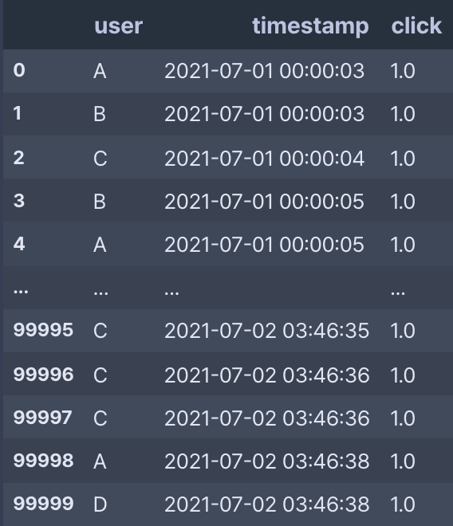
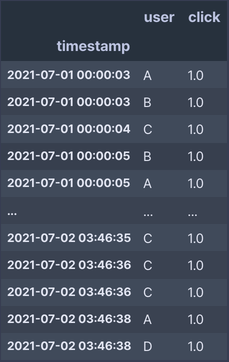
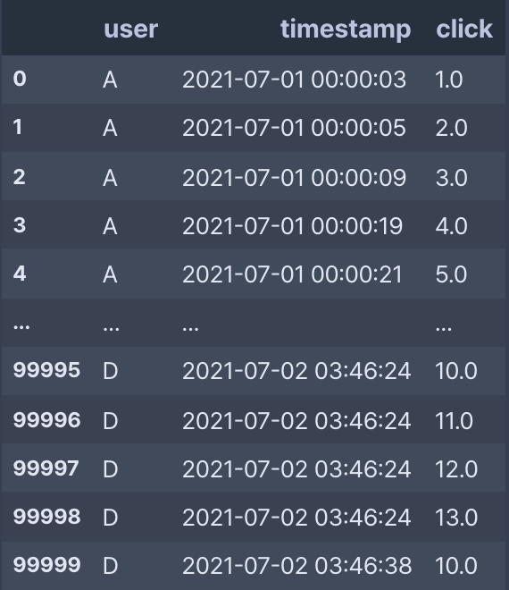

Timestamp를 Rolling Aggregation하는 방법은 생각보다 쉽습니다.

<!--more-->


## 🌃 배경

데이터를 다루다보면 필연적으로 **Group-by Operation**을 자주 접하게 됩니다. 일반적인 Group-by Operation들은 단순합니다. 그룹마다 평균을 구한다거나 중앙값을 구하거나 최댓값, 최솟값을 구합니다. 하지만 타임스탬프가 존재하고 그룹마다 타임스탬프가 서로 다르며, 단순 연산이 아닌 Rolling Mean과 같은 특정 Time Window에 대한 Aggreagation을 하게 되는 경우를 만나게 되면 문제는 복잡해집니다. 

## 🤔 케이스 스터디

이런 경우가 있다고 생각해봅시다.

- 네 명의 사용자가 임의로 특정 페이지를 클릭함
- 클릭한 타임 스탬프가 초 단위로 기록됨
- 사용자의 페이지 클릭과 관련된 새로운 Feature를 만들기 위해 **매 클릭 시점 기준 최근 30초간 클릭한 횟수의 합을 집계**하고자 함

요약하자면 사용자별로 매 클릭 시점의 30초 Rolling Sum을 생성해야 합니다. Pandas는 `rolling()` 메서드를 지원하고 Group-by한 데이터프레임에 대해서도 해당 메서드를 지원합니다. 하지만 명시적으로 타임스탬프에 대한 Rolling Aggregation은 문서에 자세히 나와있지 않습니다.

### 솔루션

우선 토이 데이터를 하나 만들겠습니다.

```python
import pandas as pd
import numpy as np
from datetime import datetime, timedelta

SIZE = 100000

users = np.random.choice(["A", "B", "C", "D"], size=SIZE, replace=True)
time_base = datetime.strptime("2021-07-01 00:00:00", "%Y-%m-%d %H:%M:%S")
ts_list = [time_base + timedelta(seconds=x) for x in range(SIZE)]
ts_list = np.random.choice(ts_list, size=SIZE, replace=True)
clicks = np.ones(SIZE)

df = pd.DataFrame({"user": users, "timestamp": ts_list, "click": clicks})
df = df.sort_values("timestamp").reset_index(drop=True)
```

아래의 데이터를 얻을 수 있습니다.




여기서 타임스탬프에 대한 Rolling Aggregation을 하기 위해선 **데이터프레임의 인덱스를 타임스탬프로 바꿔야 합니다.**

```python
df = df.set_index("timestamp")
```



인덱스를 바꾼 데이터에 `rolling()` 메서드를 사용하는데, 윈도우 크기를 30초로 설정해줘야 합니다. 최종 코드는 아래와 같습니다.

```python
df.groupby(["user"]).rolling("30S", min_period=1).sum().reset_index()
```




`"30S"` 는 윈도우 크기에 맞춰서 수정하면 하루 단위, 월 단위 등으로 바꿀 수 있습니다. 이걸 **Frequency String** 이라고 하는데 [Pandas 공식 문서](https://pandas.pydata.org/pandas-docs/stable/user_guide/timeseries.html#dateoffset-objects)에서 추가로 확인하실 수 있습니다.