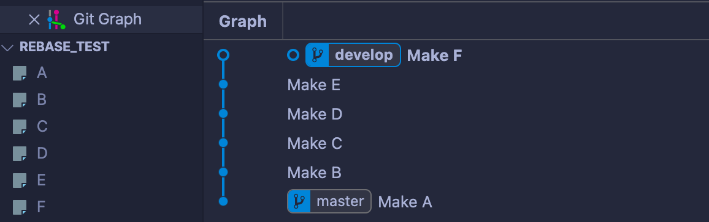
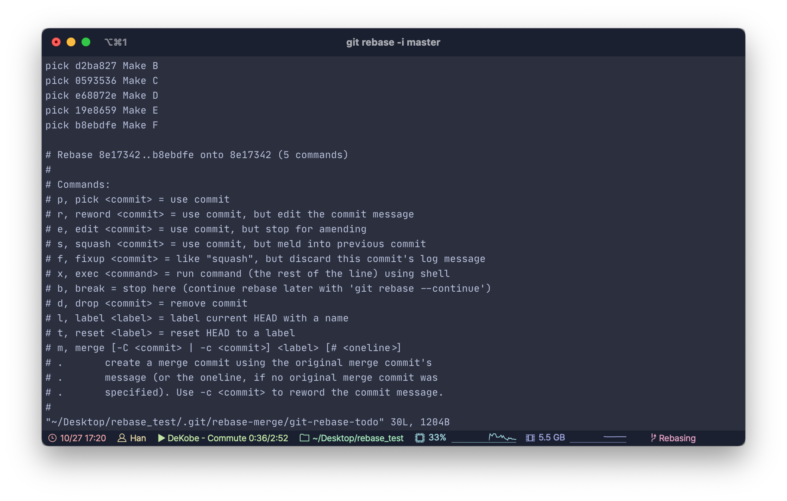
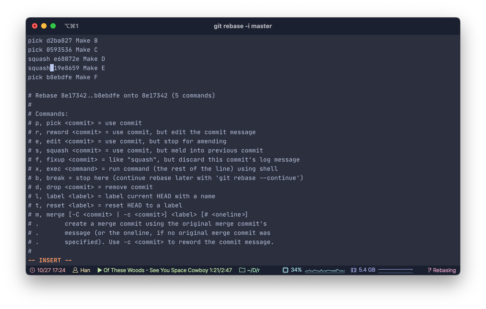
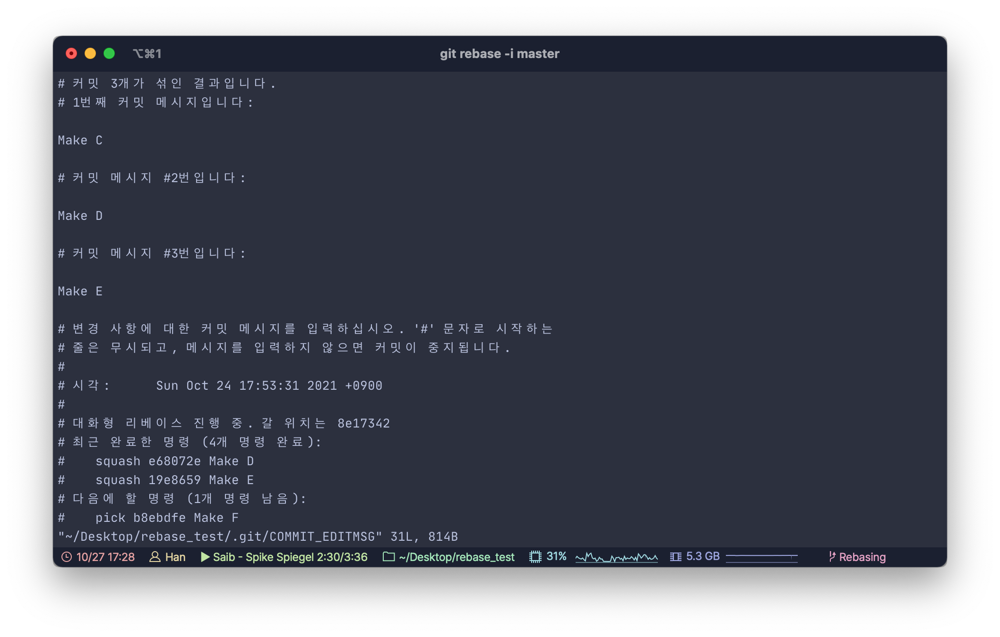
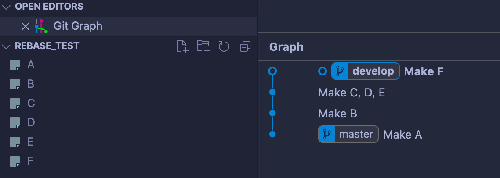

너무 많은, 자잘한 커밋도 독이 될 수 있습니다.

<!--more-->

## 🌃 배경

Git을 이용해 지금까지의 작업들을 순차적으로 커밋해왔다고 가정하겠습니다. 일련의 작업들을 커밋하고나서 확인해보니 중간의 여러 작업들을 굳이 여러 커밋으로 나눌 필요가 없음을 깨닫습니다. 아래 이미지는 지금까지의 작업에 대한 그래프입니다.



- 최초 `A` 파일 생성 후 `develop` 브랜치에서 다섯 번의 작업을 수행했습니다.
- 여기서 `C` 부터 `E` 까지의 커밋을 여러 개로 나눌 필요가 없어 합치고자 합니다.

어떻게 할 수 있을까요?

## 😎 해결

이런 문제를 해결하기 위해 **Interactive rebase**를 사용합니다. 일반적으로 리베이스(rebase)라고 하면 두 개의 브랜치를 병합할 때 기존 브랜치의 마지막 커밋 이후로 작업한 브랜치의 커밋들이 위치하게 되는 병합 방법입니다. `git rebase` 명령어로 실행을 하게 되는데, 여기에 `--interactive` 옵션을 추가하여 대화형으로 실행하게 되면 우리가 원하는 작업을 포함하여 다양한 작업을 수행할 수 있습니다.

우선 터미널를 통해 `develop` 브랜치로 가서 대화형 리베이스를 실행합니다. 작업 중인 브랜치가 `develop`이고 기존의 브랜치가 `master` 입니다. 

```bash
$ git checkout develop
$ git rebase --interactive master
```

그러면 아래의 화면이 출력됩니다. 



맨 위에 커밋 내역이 있고 그 순서는 아래로 갈 수록 최신 커밋입니다. 여기서 우리가 사용해야 하는 커맨드는 `squash` 입니다.

> `s, squash <commit>` = 커밋을 사용하되 직전의 커밋과 합쳐집니다


우리는 `C` 부터 `E` 까지의 커밋을 합쳐야 하기 때문에 세 번째와 네 번째 커밋에 대해 `pick`이 아닌 `squash` 또는 `s` 로 바꿔줍니다. 



이후 저장하면 아래와 같이 커밋 세 개가 합쳐지며 새로운 커밋 메시지를 남기라고 합니다. 저는 단순하게 `Make C, D, E` 라고만 작성했습니다.



작성 후 저장하면 `Successfully rebased and updated refs/heads/develop` 이라는 메시지와 함께 Squash가 완료됩니다. 이후 커밋 그래프를 보면 커밋들이 올바르게 합쳐진 것을 확인할 수 있습니다.

