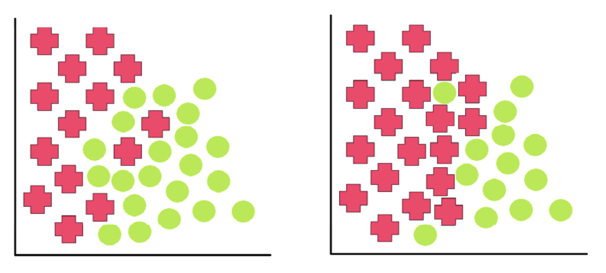
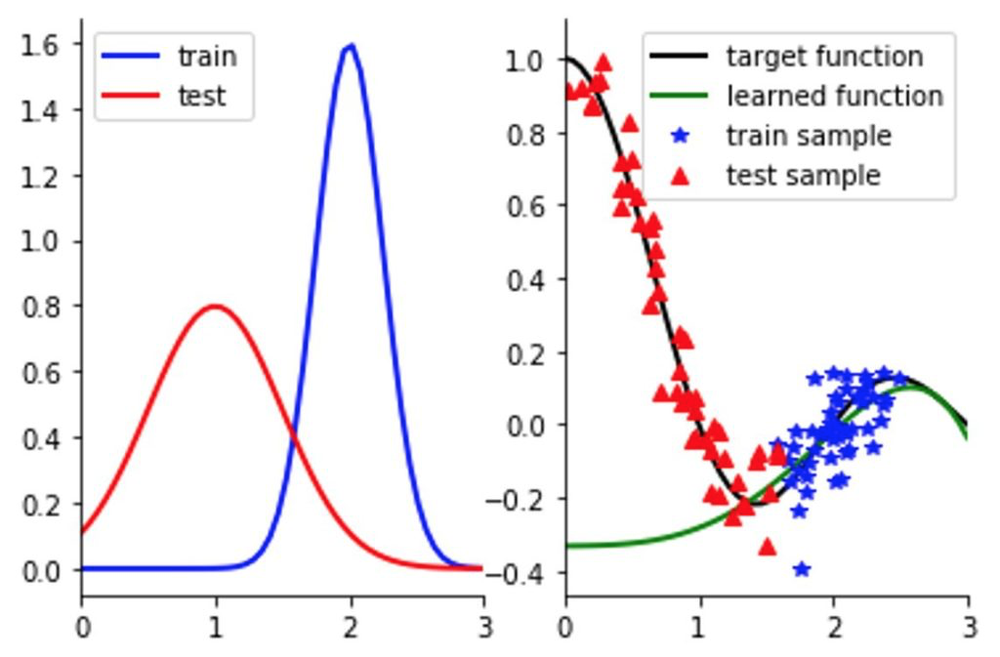
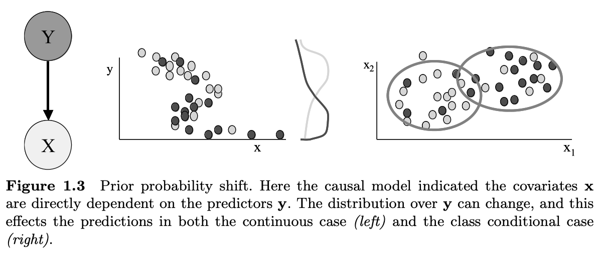

Dataset Shift는 무엇인지, 어떤 것들이 있는지 알아봅시다. 👀

<!--more-->

전체 내용이 너무 길어 두 개로 나눠 포스팅할 예정입니다. ☺️ 
1부에서는 Dataset Shift가 무엇이며 어떤 종류가 있는지, Covariate Shift와 Prior Probability Shift가 무엇인지 다룹니다.
2부에서는 Concept Shift에 대한 내용을 다룹니다.

## 들어가며

ML 프로젝트를 하다보면 매우 긴 시간 동안의 데이터를 사용하는 경우가 많습니다. 긴 시간의 데이터에선 모든 변수와 모든 타겟값이 변화가 없긴 매우 힘듭니다. 간단한 예를 들어볼까요? 어떤 회사에서 직원들의 데이터를 이용하여 각 직원들의 퇴직 확률을 예측하고자 합니다. 최근 2년간의 데이터를 사용해 모델을 만들게 되었습니다. 직원들의 퇴직도 결국 트렌드라는 것이 있기 때문에 학습/검증 데이터를 시간 순 (1년 기준)으로 나눴다고 가정해보죠. 

모델에 사용된 데이터에는 여러 피처가 있을겁니다. 예를 들어 경쟁사 대비 연봉 같은 것도 있겠죠. 하지만 경쟁사 대비 연봉을 살펴보던 중 이상한 점을 발견합니다. **2년 전의 경쟁사 대비 연봉은 낮지 않았는데, 1년 전의 경쟁사 대비 연봉은 매우 낮았습니다.** 알아보니 경쟁사의 연봉이 파격적으로 올랐던거죠. 1년 사이에 해당 피처값은 믿기지 않을 만큼 바뀌었습니다. 이렇게 학습 데이터와 테스트 데이터의 피처, 또는 타겟값의 분포가 다른 상황을 **Dataset Shift** 라고 합니다.

> *Dataset shift is a challenging situation where the joint distribution of inputs and outputs differs between the training and test stages. --  [Dataset Shift, The MIT Press](https://cs.nyu.edu/~roweis/papers/invar-chapter.pdf)*
> 

Dataset Shift는 입력 피처값이 활용되는 방식, 학습 데이터와 테스트 데이터를 선정하는 방식, 데이터의 희소성, 비정상적(non-stationary)인 환경으로 인한 데이터 변화 등으로 인해 발생합니다.  Dataset Shift는 단순한 개념일 수 있지만 ML 모델 학습은 물론이고 특히 ML 프로덕션에선 굉장히 중요한 주제입니다. 운영 중인 ML 모델에서 Dataset Shift가 발생한다면 당연히 모델 성능 하락이 발생하게 되고 **Model Staleness**가 발생하는 가장 주요 원인이 되기 때문입니다.

## Dataset Shift

<figure>
  
  <figcaption style="text-align: center;">Image from [1]</figcaption>
</figure>

Dataset Shift을 다루는 많은 아티클, 논문마다 정의하는 방식이 너무나 다릅니다. 그래서 본 포스트에서는 여러 자료들을 정리하여 되도록 일반적인 방식으로 분류해보고자 합니다. 우선 Dataset Shift는 위에서 설명드린 것처럼 학습 데이터와 테스트 데이터의 결합 분포 (Joint Distribution)이 다를 때 나타납니다. 수학적으로 표현한다면 이렇습니다.

$$P_{tr}(X, y) \neq P_{ts} (X, y)$$

Dataset Shift는 발생 원인, 현상 등을 근거로 크게 세 가지로 분류할 수 있습니다.

- Covariate Shift
- Prior Probability Shift
- Concept Shift
    - Gradual Concept Drift
    - Sudden Concept Drift
    - Recurring Concept Drift

더 세분화하여 구분하는 경우도 있습니다. Batch Normalization 논문과 함께 유명해진 Internal Covariate Shift도 그 중 하나입니다. 하지만 ML/DL 모두에 대해 일반적인 경우만 다루기 위해 본 포스트에서는 다루지 않겠습니다.

### Covariate Shift

> *Covariate shift is a simpler particular case of dataset shift where only the input distribution changes, while the conditional distribution of the outputs given the inputs $p(y \mid x)$ remains unchanged. —- [Dataset Shift, The MIT Press](https://cs.nyu.edu/~roweis/papers/invar-chapter.pdf)*
> 

<figure>
  
  <figcaption style="text-align: center;">Image from [2]</figcaption>
</figure>

Covariate Shift는 입력 피처와 레이블과의 관계는 그대로인 반면 입력 피처들의 분포가 다른 현상을 말합니다. 입력 데이터의 분포가 레이블을 잘 반영하지 못하는 경우에 많이 발생합니다.

$$P_{tr}(Y \mid X) = P_{ts} (Y \mid X) \quad \text{and} \quad P_{tr}(X) \neq P_{ts}(X)$$

Covariate Shift가 발생하는 주요 원인은 크게 두 가지로 볼 수 있습니다. [4]

- Sample Selection Bias
    - 데이터 수집 과정에서 발생하는 시스템적인 결함입니다. 이 경우엔 학습 데이터를 모집단에서 균일하지 못하게 선택하여 발생하게 됩니다.
- Non-stationary Environments
    - 학습 환경이 테스트 환경하고 다를 때 발생할 수 있습니다. 보통 시간적 또는 공간적 변화로 인해 발생합니다.

어떤 집단의 폐암 발병률을 예측한다고 가정해봅시다. 데이터에 많은 피처가 있지만 그 중에 흡연량에 대한 피처가 있습니다. 흡연량이 높을 수록 폐암 발병률이 높아진다는 것은 잘 알려진 관계입니다. 최초 모델을 학습할 때에는 해당 집단의 평균적인 흡연량이 매우 낮았습니다. 그러다보니 흡연량이 높은 집단에 대한 학습은 많이 이루어지지 못했습니다.. 그럼에도 학습 성능은 매우 좋았습니다. 시간이 흘러 동일 집단에 대해 다시 폐암 발병률을 예측하려 했는데, 이번에는 흡연량이 과거에 비해 전체적으로 높아졌습니다. **흡연량이 높아짐에 따라 폐암 발병률이 높아진다는 관계는 변함이 없지만 높은 흡연량에 대한 학습이 잘 이루어지지 않았기 때문에 예측에 대한 성능이 급격히 낮아졌습니다.**

다른 예로는 이미지 분류가 있는데요. 오렌지, 파인애플, 바나나 사진들을 학습하여 분류하는 네트워크를 만든다고 가정해봅시다. 학습 데이터에선 오렌지, 파인애플 사진이 많았고 학습 성능도 당연히 더 좋았습니다. 그런데 실제 테스트셋에는 바나나 사진들이 많이 있었고 결국 학습 대비 테스트 성능이 매우 낮아지게 되었습니다. 이 역시 입력 데이터에 대한 레이블의 관계는 바뀌지 않았지만 입력 데이터의 분포가 달라진 경우입니다.

Covariate Shift에 대해 강건한 모델을 만들기 위해서는 항상 인풋 피처들이 안정적인지 확인해야 합니다. 모델 학습 단계에서 피처들의 값이 변화할 가능성이 있는지 검증하여야 합니다. 특히 Cross-validation을 수행할 때 굉장히 편향된 결과를 초래할 수 있기 때문에 주의해야 합니다. 모델을 서빙하기 시작했더라도 꾸준한 모니터링을 수행해야 합니다.

### Prior Probability Shift

> *Prior probability shift appears only in $Y \to X$ problems, and is defined as the case where $P_{tr}(X \mid Y) = P_{ts}(X \mid Y)$ and $P_{tr}(Y) \neq P_{ts}(Y)$. —  [Herrera, Francisco. "Dataset shift in classification: Approaches and problems." International work-conference on artificial neural networks (IWANN). 2011.](https://iwann.ugr.es/2011/pdf/InvitedTalk-FHerrera-IWANN11.pdf)*

<figure>
  
  <figcaption style="text-align: center;">Image from [3]</figcaption>
</figure>

Prior Probability Shift는 입력 피처와 레이블과의 관계는 역시 그대로지만 레이블의 분포가 달라지는 현상을 말합니다. 데이터 불균형 문제를 생각해보면 쉽게 이해할 수 있습니다. 학습 데이터에서 스팸 메일에 대한 사전 확률 (Prior Probability)가 50%라고 가정해봅시다. 그러면 우리는 학습 데이터에 50%의 스팸 메일과 50%의 정상 메일이 있다고 가정할 수 있습니다. 하지만 현실에선 대부분의 메일이 스팸입니다. 이 경우엔 레이블의 분포가 변하게 됩니다. 사전 확률의 분포가 달라지게 되죠. 하지만 입력 피처들에 대한 분포는 변하지 않습니다.

이 현상은 오직 $Y \to X$ 문제에서만 발생하며, 나이브 베이즈 (Näive Bayes)가 Prior Probability Shift의 가장 좋은 예시입니다.

## References

[1] Stewart, M. (Dec 21, 2019). Understanding Dataset Shift. https://towardsdatascience.com/understanding-dataset-shift-f2a5a262a766

[2] Berkowitz, J. (Mar 23, 2021). Distribution Shift and Audio Data. https://www.iqt.org/distribution-shift-and-audio-data/

[3] Quiñonero-Candela, J., Sugiyama, M., Lawrence, N. D., & Schwaighofer, A. (Eds.). (2009). Dataset shift in machine learning. Mit Press.

[4] Das, S. (Nov 8, 2021). Best Practices for Dealing With Concept Drift. https://neptune.ai/blog/concept-drift-best-practices