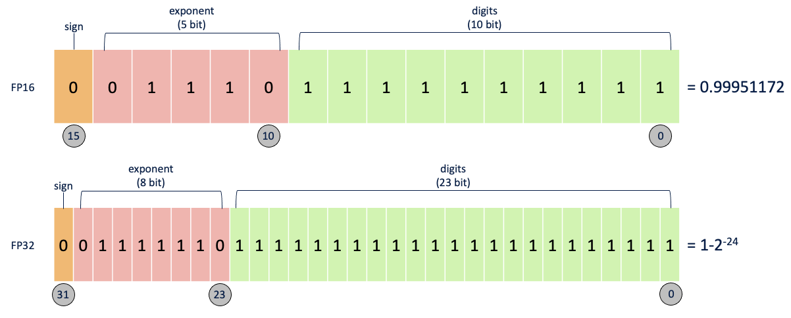
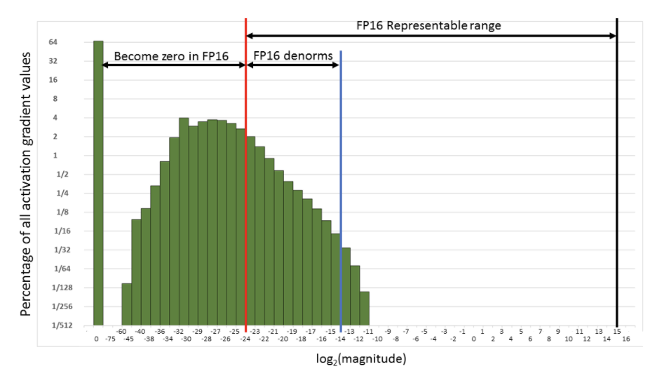
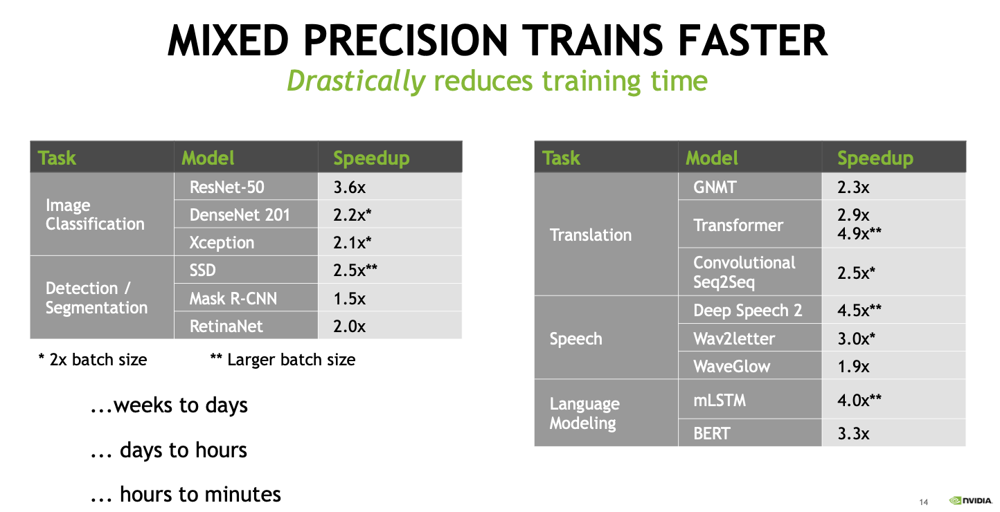
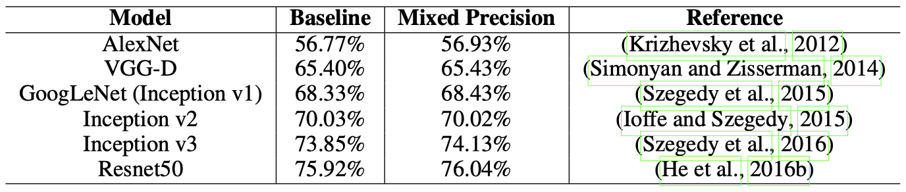
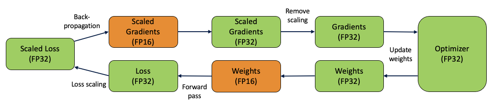

<!--more-->

## 들어가며

전 PyTorch보다는 Tensorflow나 Keras를 이용해서 모델을 구현하곤 했는데 이번에 투입된 프로젝트에선 전부 PyTorch로 짜여있었습니다.
이미 작성된 모델 코드를 보는데 NVIDIA APEX의 AMP를 사용하고 있더군요.
예전부터 Low precision에 대해서는 짧게 알고는 있었지만 이번 기회에 AMP에 대해서 더 자세히 공부해놓으면 도움이 되겠다는 생각이 들어서 본 포스트를 작성하게 되었습니다.

## 부동소수점 (Floating Point)

본격적인 내용에 앞서서 부동소수점에 대해서 알아야 합니다.
부동소수점에서 '부동'은 'floating'에서 알 수 있듯이 '움직이지 않는'다는 뜻의 不動이 아닌 '떠다닌다'는 의미의 浮動입니다.
위키피디아에서는 부동소수점을 아래와 같이 설명하고 있습니다.

> 부동소수점(浮動小數點, floating point)은 실수를 컴퓨터상에서 근사하여 표현할 때 소수점의 위치를 고정하지 않고 그 위치를 나타내는 수를 따로 적는 것

<center>
  <figure>
    
    <figcaption style="text-align: center;">Image from <a href="https://towardsdatascience.com/understanding-mixed-precision-training-4b246679c7c4">[1]</a></figcaption>
  </figure>
</center>

일반적으로 딥러닝에서는 소수점을 처리할 때 16비트나 32비트로 처리합니다.
각각을 FP16, FP32로 부르는데 위 이미지에서도 알 수 있듯이 부호를 나타내는 비트 1개는 고정이지만, 지수를 나타내는 비트, 가수를 나타내는 비트의 수가 다릅니다.

간단하게 이야기해서 더 많은 비트가 사용될 수록 정확한 연산이 가능합니다.
하지만 연산 시에는 더 적은 비트가 사용될 수록 빠른 속도를 확보할 수 있습니다.

## 딥러닝 학습과 부동소수점

### Low Precision의 장점

보통 아무런 처리를 하지 않으면 대부분의 소수는 FP32로 처리합니다.
하지만 FP32로 처리하여 모델을 학습하게 되면 어떤 문제가 발생할까요?

FP32로 모델을 학습하게 되면 Loss 계산, 그라디언트 계산 등이 매우 무거워집니다.
학습하는데 너무나 오랜 시간을 소비하게 됩니다.
특히 모델의 복잡도가 점점 커져가는 요즘 매우 치명적인 문제가 됩니다.

뿐만 아니라 GPU 메모리 관점에서도 BERT-Large 같은 큰 모델들은 단일 GPU로 학습하기 어렵습니다.
그렇다고 해서 가능한 작은 배치 크기로 학습을 하더라도 이는 데이터 병렬 처리에 제한이 있습니다.

FP16으로 학습하게 되면 위 문제점들을 어느 정도 해결할 수 있습니다.
우선 계산이 간단해지면서 학습 속도가 빨라지고 GPU 메모리 사용량이 감소합니다.
FP16으로 모델을 학습하는 경우 FP32로 학습하는 경우 대비 **절반**의 메모리가 필요합니다.
메모리와 네트워크 대역폭을 절약할 수 있고 배치 사이즈를 크게 할 수 있습니다.
이는 추가적인 학습 속도 상승을 기대해볼 수 있죠.

### Low Precision의 문제점

이렇게 장점만 있는 것 같지만 다음 설명할 문제가 굉장히 큰 문제가 됩니다.
당연히 FP16은 FP32보다 표현할 수 있는 숫자가 굉장히 적습니다.
예를 들어서 $1 + 10^{-4}$를 FP16과 FP32로 계산하면 어떻게 될까요?
- 우선 FP32로 계산하면 $1.0001$로 올바른 값을 얻을 수 있습니다.
- **하지만 FP16에선 1**로 계산 됩니다.

```python
>>> import numpy as np

>>> a = 1 + 10 ** -4

>>> np.float32(a)
1.0001
>>> np.float16(a)
1.0
```

이처럼 FP16은 Dynamic range가 매우 작습니다.
그러다보니 Numeric overflow나 Numeric underflow가 발생할 수 있죠.
그렇게 되면 모델 학습 시 정확도가 낮아지는 문제가 생기고, 심지어는 loss function이 수렴하지 않고 발산할 수도 있습니다.

<center>
  <figure>
    
    <figcaption style="text-align: center;">Image from <a href="https://docs.nvidia.com/deeplearning/performance/mixed-precision-training/index.html#training">[3]</a></figcaption>
  </figure>
</center>

위 이미지는 Multibox SSD network를 FP32로 학습했을 때 activation의 그라디언트 값을을 히스토그램으로 나타낸 것입니다.
보시다시피 그라디언트는 일반적으로 매우 작은 값입니다.
FP16으로는 대부분 표현하기 어렵죠.
실제로 빨간선을 기준으로 왼쪽에 있는 값들은 FP16에서 0이 됩니다.
오른쪽에 있는 값들 중에서도 FP16에서는 대부분이 비정규화된 수 (Denormalized numbers)이기 때문에 전체 값들 중에서 5.3%만이 학습에 사용되며 결국 학습 시 발산하게 됩니다.
게다가 대부분의 표현 가능한 범위는 쓰이지도 않습니다.


### Mixed Precision

위 문제를 해결하기 위해 FP16과 FP32를 함께 사용하는 것이 **Mixed precision** 입니다.
대부분의 경우에 FP16을 사용하고 특정 경우에만 FP32를 사용해서 학습하는 것인데요.
계산 시 수치적으로 위험한 경우나 값을 백업하는 용도로 주로 사용합니다.
Numerical-safety 레벨에 맞춰서 연산을 분류하면 다음과 같습니다. [2]

- 수치적으로 안전하고 성능에 큰 영향을 미치는 경우 : Convolution, Matmul $\rightarrow$ FP16
- 수치적 중립 : Max, Min $\rightarrow$ 상황에 따라서
- (조건부로) 수치적으로 안전 : Activations $\rightarrow$ 상황에 따라서
- 수치적으로 위험함 : Exp, Log, Pow, Softmax, Reduction Sum, Mean $\rightarrow$ FP32

Mixed precision으로 학습하면 학습 속도 뿐만 아니라 성능 향상까지 기대할 수 있습니다. [4] [5]

<center>
  <figure>
    
    <figcaption style="text-align: center;">Image from <a href="https://nvlabs.github.io/iccv2019-mixed-precision-tutorial/files/dusan_stosic_intro_to_mixed_precision_training.pdf">[4]</a></figcaption>
  </figure>
</center>

<center>
  <figure>
    
    <figcaption style="text-align: center;">Image from <a href="https://arxiv.org/abs/1710.03740">[5]</a></figcaption>
  </figure>
</center>

### Loss Scaling

<center>
  <figure>
    
    <figcaption style="text-align: center;">Image from <a href="https://towardsdatascience.com/understanding-mixed-precision-training-4b246679c7c4">[1]</a></figcaption>
  </figure>
</center>

Mixed precision으로 학습할 때 Loss Scaling은 다음의 순서로 이루어집니다. [3]

1. FP32 가중치 카피 생성
2. 매 이터레이션마다
    1. 가중치의 FP16 카피 생성
    2. Forward propagation (FP16 가중치, activations)
    3. Loss 결과에 scaling factor $\mathcal{S}$ 곱함
        1. FP16이기 때문에 위 그림에서 알 수 있듯 매우 작은 값일 가능성이 높음. Scaling factor 곱해서 값을 임시로 크게 만듦
    4. Backward propagation (FP16 가중치, activations, 그라디언트)
    5. 가중치 그라디언트에 $\frac{1}{\mathcal{S}}$ 곱함
    6. 가중치 업데이트

### Dynamic Loss Scaling

일반적인 Loss Scaling은 보다시피 Scaling factor $\mathcal{S}$를 사전에 정해야 합니다.
하지만 scaling factor를 큰 값으로 초기화한 후 가중치 그라디언트에 잘못된 값이 들어갈 때 scaling factor를 줄이는 방식을 사용하여 Dynamic Loss Scaling을 수행할 수 있습니다. [3]

1. FP32 가중치 카피 생성
2. Scaling factor $\mathcal{S}$을 큰 값으로 초기화
3. 매 이터레이션마다
    1. 가중치의 FP16 카피 생성
    2. Forward propagation (FP16 가중치, activations)
    3. Loss 결과에 Scaling factor $\mathcal{S}$ 곱함
    4. Backward propagation (FP16 가중치, activations, 그라디언트)
    5. 가중치 그라디언트에 `Inf`나 `NaN`이 있는 경우
        1. $\mathcal{S}$를 줄임
        2. 가중치 업데이트를 스킵하고 다음 이터레이션으로 넘어감
    6. 가중치 그라디언트에 $\frac{1}{\mathcal{S}}$ 곱함
    7. 가중치 업데이트 (그라디언트 클리핑 포함할 수도 있고)
    8. 최근 `N`번의 이터레이션동안 `Inf`나 `NaN`이 없었다면 $\mathcal{S}$ 증가

## NVIDIA APEX

### APEX

NVIDIA에서는 Pytorch에서 사용 가능한 여러 가지 확장 기능들을 제공하는 APEX (A PyTorch Extension) 개발하여 배포하고 있습니다.
여러 가지 기능을 제공하지만 그 중에서도 Mixed Precision Training 기능을 제공하며, Automatic Mixed Precision을 제공합니다.

> `apex.amp` is a tool to enable mixed precision training by changing only 3 lines of your script. Users can easily experiment with different pure and mixed precision training modes by supplying different flags to `amp.initialize`.

NVIDIA에서는 리눅스에 설치하는 것을 권장하고 있으며, 모든 기능을 다 사용하기 위해서는 CUDA와 C++ 익스텐션을 같이 설치해야 합니다.

```bash
git clone https://github.com/NVIDIA/apex
cd apex
pip install -v --disable-pip-version-check --no-cache-dir --global-option="--cpp_ext" --global-option="--cuda_ext" ./
```

Python-only 빌드도 지원을 합니다.

```bash
pip install -v --disable-pip-version-check --no-cache-dir ./
```

### AMP 사용하기

AMP를 사용하는 방법은 다음과 같습니다.

```python
from apex import amp
# Declare model and optimizer as usual, with default (FP32) precision
model = torch.nn.Linear(D_in, D_out).cuda()
optimizer = torch.optim.SGD(model.parameters(), lr=1e-3)

# Allow Amp to perform casts as required by the opt_level
model, optimizer = amp.initialize(model, optimizer, opt_level="O1")
...
# loss.backward() becomes:
with amp.scale_loss(loss, optimizer) as scaled_loss:
    scaled_loss.backward()
...
```

Line 6부터 AMP를 적용한 코드입니다.
우선 최적화 모드 (optimization level)을 정해서 AMP를 `initialize`하고 loss scaling을 수행합니다.
Loss scaling은 `amp.scale_loss().backward()`로 수행합니다.

#### `opt_level`

최적화 모드는 `"O0"`, `"O1"`, `"O2"`, `"O3"`로 총 네 가지가 있습니다.

- `O0` : FP32 학습
  - AMP를 적용하지 않으며 베이스라인 모델이라고 생각하면 됩니다.
- `O1` : Mixed Precision
  - 일반적으로 권장하는 모드입니다.
  - Tensor core에 적합한 연산들은 FP16으로, 정확한 연산을 요구하는 부분은 FP32로 계산합니다.
  - Dynamic loss scaling을 사용합니다.
  - 모델 가중치는 FP32로 유지시킵니다.
- `O2` : "Almost FP16" Mixed Precision
  - `O1` 모드와 비교하여 FP16을 더 많이 사용합니다.
  - FP32 batchnorm, FP32 master weight를 제외하고는 모두 FP16을 사용합니다.
  - Dynamic loss scaling을 사용합니다.
- `O3` : FP16 학습
  - FP32 batchnorm을 제외하고 모두 FP16을 사용하기 때문에 매우 빠른 속도로 학습합니다.
  - 만약 batch normalization을 사용하고 있다면 추가 인자를 사용해야 합니다. (`keep_batchnorm_fp32=True`)
  - Dynamic loss scaling을 사용합니다.

## References

[1] [Understanding Mixed Precision Training by Jonathan](https://towardsdatascience.com/understanding-mixed-precision-training-4b246679c7c4)

[2] [AMP Training Tutorial by Bojian Zheng](https://www.cs.toronto.edu/ecosystem/documents/AMP-Tutorial.pdf)

[3] [NVIDIA Deep Learning Performance Documentation](https://docs.nvidia.com/deeplearning/performance/mixed-precision-training/index.html)

[4] [Introduction to Mixed Precision Training by Dusan Stosic, NVIDIA](https://nvlabs.github.io/iccv2019-mixed-precision-tutorial/files/dusan_stosic_intro_to_mixed_precision_training.pdf)

[5] [Micikevicius, Paulius, et al. "Mixed precision training." arXiv preprint arXiv:1710.03740 (2017).](https://arxiv.org/abs/1710.03740)