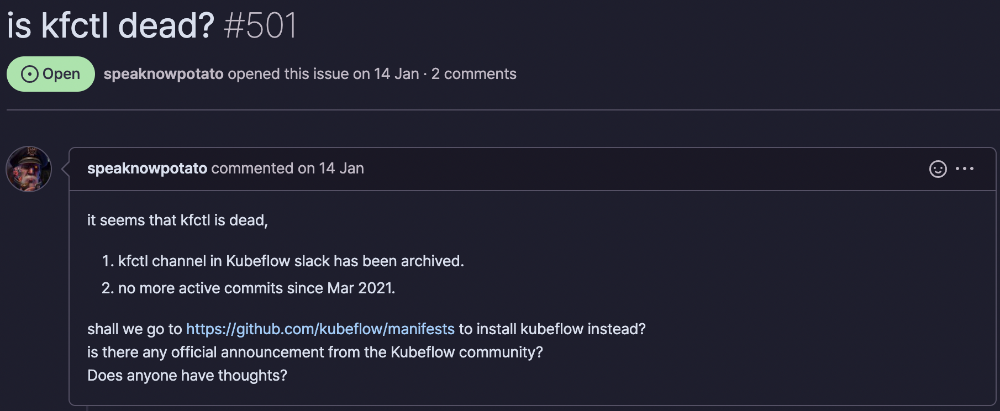

Chapter 2: Hello Kubeflow

<!--more-->


>   본 포스트는 [Kubeflow for Machine Learning](https://oreilly.com/library/view/kubeflow-for-machine/9781492050117/) 책을 발췌/요약하면서 필요한 내용은 추가하여 작성하였습니다.
>
>   -   [Chapter 1: Kubeflow: What It is and Who It Is For](/kubeflow/2022/05/08/kubeflow-chapter1.html)
>   -   [Chapter 2: Hello Kubeflow](/kubeflow/2022/05/15/kubeflow-chapter2.html)
>   -   [Chapter 3: Kubeflow Design: Beyond the Basics](/kubeflow/2022/06/19/kubeflow-chapter3.html)
>   -   [Chapter 4: Kubeflow Pipelines](/kubeflow/2022/07/10/kubeflow-chapter4.html)
>   -   Chapter 5: Data and Feature Preparation
>   -   Chapter 6: Artifact and Metadata Store
>   -   Chapter 7: Training a Machine Learning Model
>   -   Chapter 8: Model Inference
>   -   Chapter 9: Case Study Using Multiple Tools
>   -   Chapter 10: Hyperparameter Tuning And Automated Machine Learning

## Introduction

원래 책의 본 장은 `kubectl`과 `kfctl` 을 이용하여 Kubeflow를 설치하는 내용을 다루고 있습니다. 처음 공부하는 입장에서 책의 내용을 따라가고 있었는데 `kubeflow/kfctl` 저장소가 유지보수가 되지 않는 것을 보고 조금 의아했습니다. 저장소의 마지막 커밋이 2021년 3월 16일이고 관리가 어떻게 되고 있는지에 대한 정보는 찾아볼 수 없었습니다. 그러던 중 다음과 같은 [이슈](https://github.com/kubeflow/kfctl/issues/501)가 등록되어 있는 것을 확인했는데요.

<center>
  <figure>
    
    <figcaption style="text-align: center;">kfctl is deprecated... 💀</figcaption>
  </figure>
</center>

내용인 즉 Kubeflow 1.3 이후 버전부터는 모두 `kustomize`를 이용해서만 배포 가능하며, 현재 커뮤니티 내에 `kfctl`을 지원하거나 개발하는 인원이 전무하다는 것입니다. 문제는 `kfctl`을 아예 사용하지 않는 것도 아니고 일부 컴포넌트에서는 아직 `kfctl`을 사용하고 있는 것으로 보여 결국 설치는 해야하는 것 같습니다.

그래서 본 포스트에서는 책의 설치 내용을 따라가지 않고 Kubeflow 최신 버전을 Manifest를 이용해 설치하는 방법을 별도로 다루고자 합니다.

## How to install Kubeflow?

하나 알아두셔야 할 내용은 아래 설치 방법은 M1 Mac이 아닌 Intel Mac에서만 가능합니다. 다른 OS나 환경에서는 설치 방법이 다를테니 관련 문서를 확인하여 설치를 진행하시기 바랍니다. Kubeflow는 최신 버전으로 설치할 예정입니다. 

### Install Minikube

Homebrew를 이용해서 Minikube를 설치해줍니다.

```bash
brew install minikube
```

설치가 완료된 후 버전 확인을 해줍니다.

```bash
> minikube version
minikube version: v1.25.2
commit: 362d5fdc0a3dbee389b3d3f1034e8023e72bd3a7
```

### Install Kubernetes

이제 Minikube에서 쿠버네티스를 설치할텐데 버전 선택에 주의해야 합니다. [Kubeflow Manifest 저장소](https://github.com/kubeflow/manifests)에서 쿠버네티스 1.22 이상 버전과는 호환성 문제가 있을 수 있어 설치에 주의를 요하고 있습니다.
참고로 M1 맥에서는 Minikube 드라이버를 반드시 Docker로 설정해야 합니다. 본 포스트는 Intel Mac에서 가능한 내용입니다. 따라서 M1이면서 Docker가 설치되지 않은 경우 [관련 문서](https://minikube.sigs.k8s.io/docs/drivers/docker/)를 확인하여 Docker를 설치 및 설정 후 Kuberntetes를 설치하시기 바랍니다.

> M1으로 Minikube를 이용해 Kubeflow 설치가 안되는 이유는 Kubeflow의 컴포넌트 중 Istio가 올바르게 작동하지 않기 때문입니다.
> 확인 결과 현재 Istio는 공식적으로 M1 Mac (arm64)를 지원하지 않고 있습니다.
> 대부분의 컴포넌트는 문제가 없으나 가장 중요한 컴포넌트 중 하나인 Istio를 지원하지 않으므로 설치와 사용에 어려움이 있습니다.
> 만약 반드시 M1 Mac을 통해 Kubeflow를 설치해야 한다면 가상 환경을 이용해 Linux 환경을 구축하여 설치하시기 바랍니다.

```bash
> minikube start --driver=hyperkit --kubernetes-version=1.21.12 --memory=8g —cpus=4 --profile kf
😄  [kf] Darwin 12.3.1 (arm64) 의 minikube v1.25.2
✨  유저 환경 설정 정보에 기반하여 docker 드라이버를 사용하는 중
👍  kf 클러스터의 kf 컨트롤 플레인 노드를 시작하는 중
🚜  베이스 이미지를 다운받는 중 ...
    > gcr.io/k8s-minikube/kicbase: 343.11 MiB / 343.12 MiB  100.00% 11.41 MiB p
🔥  Creating docker container (CPUs=4, Memory=8192MB) ...
🐳  쿠버네티스 v1.21.12 을 Docker 20.10.12 런타임으로 설치하는 중
    ▪ kubelet.housekeeping-interval=5m
    > kubelet.sha256: 64 B / 64 B [--------------------------] 100.00% ? p/s 0s
    > kubeadm.sha256: 64 B / 64 B [--------------------------] 100.00% ? p/s 0s
    > kubectl.sha256: 64 B / 64 B [--------------------------] 100.00% ? p/s 0s
    > kubectl: 41.31 MiB / 41.31 MiB [-------------] 100.00% 19.68 MiB p/s 2.3s
    > kubeadm: 39.56 MiB / 39.56 MiB [-------------] 100.00% 12.83 MiB p/s 3.3s
    > kubelet: 104.79 MiB / 104.79 MiB [-----------] 100.00% 31.86 MiB p/s 3.5s
    ▪ 인증서 및 키를 생성하는 중 ...
    ▪ 컨트롤 플레인이 부팅...
    ▪ RBAC 규칙을 구성하는 중 ...
🔎  Kubernetes 구성 요소를 확인...
    ▪ Using image gcr.io/k8s-minikube/storage-provisioner:v5
🌟  애드온 활성화 : storage-provisioner, default-storageclass
🏄  끝났습니다! kubectl이 "kf" 클러스터와 "default" 네임스페이스를 기본적으로 사용하도록 구성되었습니다.
```

여기서 만약 도커 컨테이너가 원하는 설정 (4개의 CPU, 8GB의 메모리)으로 생성되지 않았다면 클러스터를 삭제한 다음 Minikube의 기본값을 설정한 다음 재생성하면 됩니다.

```bash
# Minikube 삭제
minikube delete -p kf

# Minikube 기본값 설정
minikube config set cpus 4
minikube config set memory 8192
```

올바르게 프로파일이 생성되었는지 확인하기 위해 다음의 명령어를 실행합니다.

```bash
> minikube profile list

|---------|-----------|---------|--------------|------|----------|---------|-------|
| Profile | VM Driver | Runtime |      IP      | Port | Version  | Status  | Nodes |
|---------|-----------|---------|--------------|------|----------|---------|-------|
| kf  | docker    | docker  | XXX.XXX.XX.X | XXXX | v1.21.12 | Running |     1 |
|---------|-----------|---------|--------------|------|----------|---------|-------|
```

### Install Kustomize

쿠버네티스 패키징 매니지 툴인 Kustomize도 설치해줍니다. 이 역시 쿠버네티스처럼 버전 제약 사항이 있었는데요. 최근 버전인 4.X 버전과는 호환이 되지 않아 그보다 낮은 버전을 설치해야 합니다. 3.2.0 버전 설치를 권장하는데 지금 Kustomize 3.10.0 버전까지 나와 있어 저는 그냥 3.10.0 버전을 설치했습니다. [다운로드 페이지](https://github.com/kubernetes-sigs/kustomize/releases/tag/kustomize%2Fv3.10.0)에서 OS에 맞는 파일을 다운 받습니다.

```bash
wget https://github.com/kubernetes-sigs/kustomize/releases/download/kustomize%2Fv3.10.0/kustomize_v3.10.0_darwin_amd64.tar.gz
```

그 다음 압축을 풀고 파일을 `PATH` 경로에 넣어줍니다.

```bash
tar -zxvf kustomize_v3.10.0_darwin_amd64.tar.gz
sudo mv kustomize /usr/local/bin/kustomize
```

마지막으로 설치 확인을 합니다.

```bash
> kustomize version

{Version:kustomize/v3.10.0 GitCommit:602ad8aa98e2e17f6c9119e027a09757e63c8bec BuildDate:2021-02-10T00:00:50Z GoOs:darwin GoArch:amd64}
```

### Install Kubeflow

여기까지 되었다면 Kubeflow를 설치할 수 있습니다. 우선 Kubeflow Manifests 저장소에서 최신 버전 소스를 복사해옵니다.

```bash
git clone https://github.com/kubeflow/manifests.git
```

그 다음 Kubeflow를 다음의 명령어를 이용해서 설치합니다.

```bash
cd manifests
while ! kustomize build example | minikube -p=kf kubectl -- apply -f -; do echo "Retrying to apply resources"; sleep 10; done
```

저장소 내의 설치 명령어와 다른 점은 `minikube -p=kf` 로 `kubectl` 앞에 다른 것이 붙여져 있는 것인데요. 우리는 Minikube를 이용해 설치하고 있으므로 Minikube 내의 `kubectl` 을 이용해야 하기 때문에 위 명령어를 사용합니다.

설치를 완료하고 Kubeflow의 Pod들이 올바르게 기동되고 있는지 확인합니다.

```bash
minikube -p=kf kubectl -- get pods -A
```

모든 Pod이 Running인 것을 확인하여 설치를 완료하면 됩니다.
