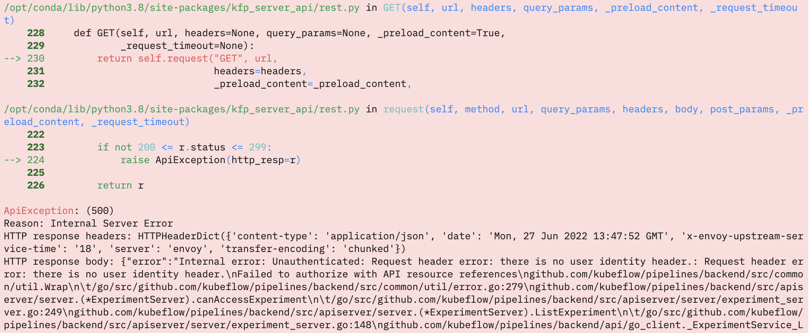
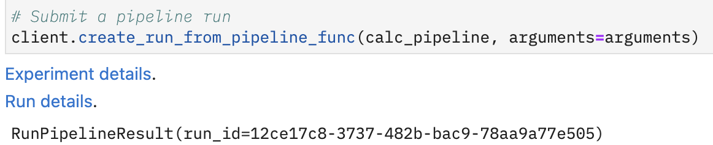

<!--more-->

## 문제 발생

Kubeflow Pipelines에서 간단한 파이프라인을 생성하고 실행하기 위해 다음과 같이 코드를 작성하였다고 해보죠.

```python
import kfp

client = kfp.Client()
client.create_run_from_pipeline_func(pipeline, arguments=arguments)
```

그런데 이런 에러가 발생하는 경우가 있습니다.

```
ApiException: (500)
Reason: Internal Server Error
HTTP response headers: HTTPHeaderDict({'content-type': 'application/json', 'date': 'Mon, 27 Jun 2022 13:47:52 GMT', 'x-envoy-upstream-service-time': '18', 'server': 'envoy', 'transfer-encoding': 'chunked'})
HTTP response body: {"error":"Internal error: Unauthenticated: Request header error: there is no user identity header.: Request header error: there is no user identity header...
```

다른건 몰라도 **인증 관련 문제**인건 확실히 알 수 있습니다. 비슷한 케이스를 찾아보기 위해 구글링을 하다가 [공식 문서](https://www.kubeflow.org/docs/components/pipelines/sdk/connect-api/#connect-to-kubeflow-pipelines-from-outside-your-cluster)에서 다음과 같은 내용을 확인할 수 있었습니다.

>   Note, for Kubeflow Pipelines in multi-user mode, you cannot access the API using kubectl port-forward because it requires authentication.

저는 최신 버전의 Kubeflow를 설치하였기 때문에 당연히 Kubeflow Pipelines도 multi-user mode로 설치되었고 이에 따른 인증 문제가 발생하였음을 알 수 있었습니다.

<center>
  <figure>
    
    <figcaption style="text-align: center;">살벌한 에러가 발생합니다.</figcaption>
  </figure>
</center>

## 문제 해결

### Kubeflow Pipelines 설치 시 Multi-user Mode 끄기

해결 방법은 여러 가지가 있을 수 있는데요. 당연히 권장하는 방법은 아니겠지만 Kubeflow Pipelines 설치 시 multi-user mode를 아예 끄는 방법이 있습니다. Multi-user mode를 끄기 위해서는 Kubeflow 설치를 위한 `manifests` 폴더 내의 Kubeflow Pipelines 환경 설정 파일을 수정하면 됩니다.

```
manifests/apps/pipeline/upstream/base/installs/multi-user/api-service/params.env
```

해당 파일의 내용은 다음과 같습니다.

```
MULTIUSER=true
DEFAULTPIPELINERUNNERSERVICEACCOUNT=default-editor
VISUALIZATIONSERVICE_NAME=ml-pipeline-visualizationserver
VISUALIZATIONSERVICE_PORT=8888
```

첫번째 줄을 `MULTIUSER=false`로 바꾼 다음 Kubeflow를 전체 재설치하거나 Kubeflow Pipelines를 재설치하면 됩니다.

### 실제 접근을 허용하기

Jupyter Notebook 환경에서 Kubeflow Pipelines API 접근이 허용되지 않는 문제이므로 사용자 프로파일 네임스페이스마다 manifests를 작성하여 접근을 허용할 수 있습니다. 가장 정석적인 방법이자 실제 운영 환경에서 사용해야하는 방법인데요. 전 이 방법을 사용하여 문제를 해결하지 않아 자세한 내용은 [공식 문서](https://www.kubeflow.org/docs/components/pipelines/sdk/connect-api/#multi-user-mode)로 대체하도록 하겠습니다. 나중에 이 방법으로 문제를 해결하게 되면 업데이트하도록 하겠습니다.

### Dex 인증 쿠키를 이용하기

제가 사용한 방법이고 위 방법들보다 훨씬 간단하게 해결할 수 있는 방법입니다. Central Dashboard를 접근할 때 사용하는 인증 쿠키를 이용해 Kubeflow Pipelines 인증을 해결하는 방식입니다. 간단하게 해당 세션의 쿠키를 가지고 `kfp.Client()` 초기화 시에 활용하면 됩니다. 아래 코드를 사용하시면 됩니다.

```python
import kfp
import requests

HOST = "<HOST ADDRESS>"  # Central Dashboard 접근 주소 (포트 포함)
USERNAME = "<USERNAME>"
PASSWORD = "<PASSWORD>"
NAMESPACE = "YOUR-KF-UI-NAMESPACE" # 보통 kubeflow가 기본값입니다.

session = requests.Session()
response = session.get(HOST)

headers = {
    "Content-Type": "application/x-www-form-urlencoded",
}

data = {"login": USERNAME, "password": PASSWORD}
session.post(response.url, headers=headers, data=data)
session_cookie = session.cookies.get_dict()["authservice_session"]

client = kfp.Client(
	host=f"{HOST}/pipeline",
    cookies=f"authservice_session={session_cookie}",
    namespace=NAMESPACE,
)
client.create_run_from_pipeline_func(pipeline, arguments=arguments)
```

파이프라인을 실행하면 다음과 같이 정상적으로 실행되는 것을 확인할 수 있습니다.

<center>
  <figure>
    
    <figcaption style="text-align: center;">실행에 성공하면 이런 메시지가 출력됩니다.</figcaption>
  </figure>
</center>
