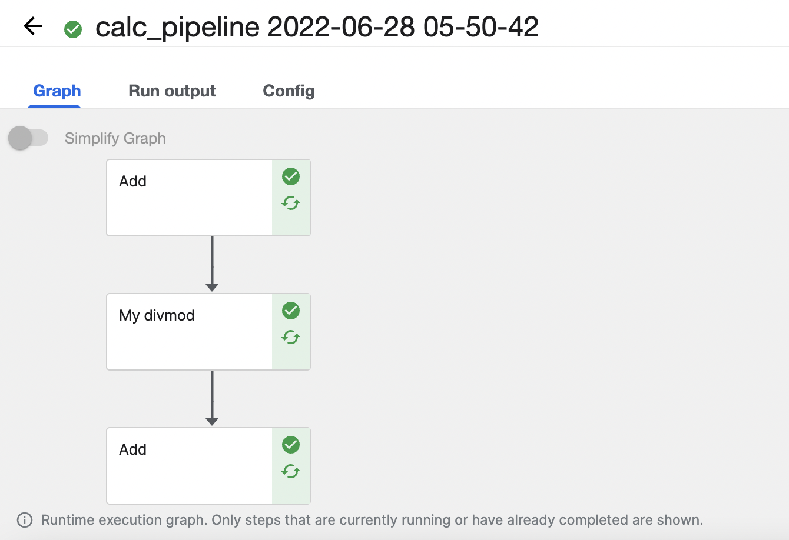
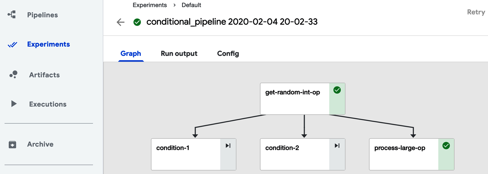
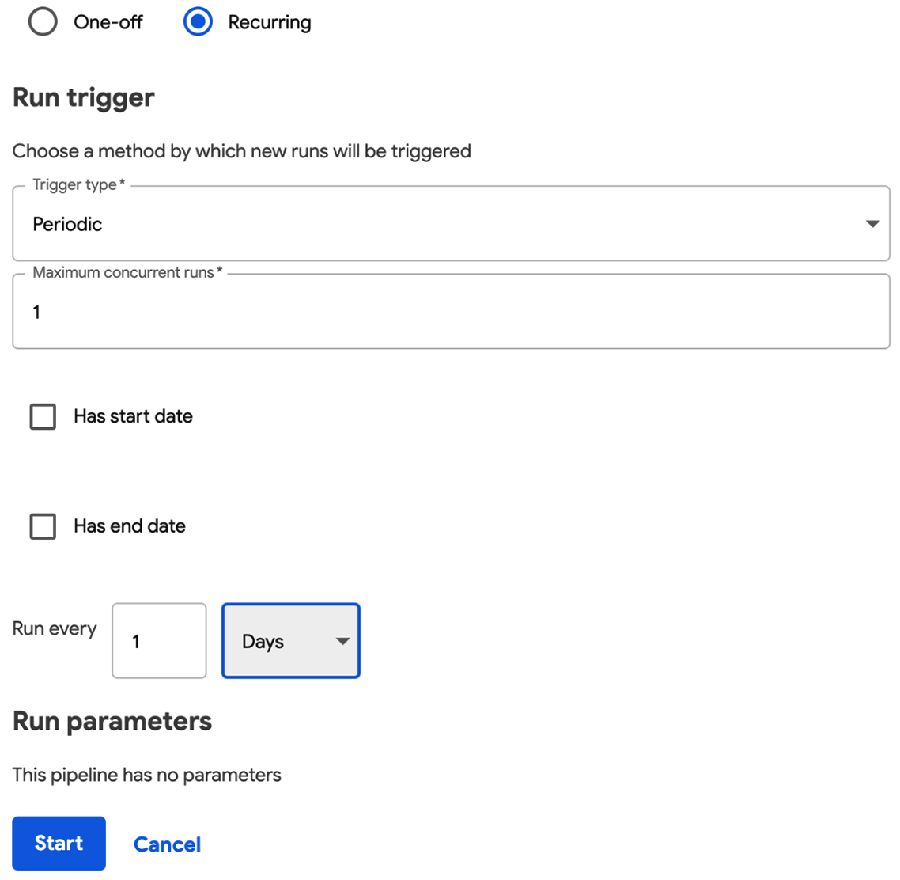

Chapter 4: Kubeflow Pipelines

<!--more-->


>   본 포스트는 [Kubeflow for Machine Learning](https://oreilly.com/library/view/kubeflow-for-machine/9781492050117/) 책을 발췌/요약하면서 필요한 내용은 추가하여 작성하였습니다.
>
>   -   [Chapter 1: Kubeflow: What It is and Who It Is For](/kubeflow/2022/05/08/kubeflow-chapter1.html)
>   -   [Chapter 2: Hello Kubeflow](/kubeflow/2022/05/15/kubeflow-chapter2.html)
>   -   [Chapter 3: Kubeflow Design: Beyond the Basics](/kubeflow/2022/06/19/kubeflow-chapter3.html)
>   -   [Chapter 4: Kubeflow Pipelines](/kubeflow/2022/07/10/kubeflow-chapter4.html)
>   -   Chapter 5: Data and Feature Preparation
>   -   Chapter 6: Artifact and Metadata Store
>   -   Chapter 7: Training a Machine Learning Model
>   -   Chapter 8: Model Inference
>   -   Chapter 9: Case Study Using Multiple Tools
>   -   Chapter 10: Hyperparameter Tuning And Automated Machine Learning

## Getting Started with Pipelines

Kubeflow Pipelines 플랫폼은 다음을 포함하고 있스빈다.

-   파이프라인을 관리, 추적하고 실행할 수 있도록 하는 UI
-   파이프라인 실행 스케줄링을 위한 엔진
-   Python에서 파이프라인을 정의, 구축, 배포하기 위한 SDK
-   SDK와 파이프라인 실행을 위한 노트북 지원

### Building a Sipmle Pipeline in Python

Kubeflow Pipelines은 Argo로 실행되는 YAML 파일로 저장됩니다. Kubeflow에서는 Python DSL (Domain-Specific Language)을 이용해 파이프라인을 작성할 수 있습니다. 파이프라인은 본질적으로 컨테이너 실행으로 구성된 그래프입니다.  실행할 컨테이너를 순서대로 지정할 뿐만 아니라 전체 파이프라인과 컨테이너들 사이에 인자를 전달할 수도 있습니다.

파이프라인은 다음의 순서로 작업합니다.

-   컨테이너 생성 (간단한 Python 함수나 도커 컨테이너)
-   해당 컨테이너 뿐만 아니라 명령줄 인수, 데이터 탑재, 컨테이너에 전달할 변수 등을 참조하는 작업(operation) 생성
-   병렬로 진행할 작업과 사전 작업 등을 정의하여 순서대로 지정
-   Python으로 정의한 파이프라인을 Kubeflow Pipelines이 사용할 수 있도록 YAML로 컴파일

다음은 간단한 파이프라인을 만드는 예제입니다. 우선 파이프라인을 구성하는 오퍼레이션을 생성하는 코드입니다.

```python
from collections import namedtuple
from typing import NamedTuple

import kfp
from kfp import compiler
import kfp.dsl as dsl
import kfp.notebook
import kfp.components as comp

def add(a: float, b: float) -> float:
    """Calculates sum of two arguments"""
    return a+b

# 함수를 파이프라인 오퍼레이션으로 변환
add_op = comp.func_to_container_op(add)

def my_divmod(dividend: float, divisor: float) -> \
	NamedTuple("MyDivmodOutput", [("quotient", float), ("remainder", float)]):
    """Divides two numbers and calculate the quotient and remainder"""
    # 컴포넌트 함수 안에 라이브러리 임포트
    import numpy as np
    
    def divmod_helper(dividend, divisor):
        return np.divmod(dividend, divisor)
    
    (quotient, remainder) = divmod_helper(dividend, divisor)
    
    divmod_output = namedtuple("MyDivmodOutput", ["quotient", "remainder"])
    return divmod_output(quotient, remainder)

# 위 함수를 파이프라인 오퍼레이션으로 변환하면서 베이스 이미지 명시
divmod_op = comp.func_to_container_op(
    my_divmod, 
    base_image="tensorflow/tensorflow:1.14.0-py3"
)
```

필요한 오퍼레이션을 다 만들었다면 이제 파이프라인을 구성하면 됩니다.

```python
@dsl.pipeline(
	name="Calculation pipeline",
    description="A toy pipeline that performs arithmetic calculations."
)
def calc_pipeline(
	a="a",
    b="7",
    c="17",
):
    # 파이프라인 파라미터를 전달하고 오퍼레이션 인자로 상수를 전달
    add_task = add_op(a, 4)
    
    # 위에서 생성한 태스크의 아웃풋을 다음 오퍼레이션의 인자로 사용
    # 위 오퍼레이션은 단일값을 반환하므로 단순히 `task.output`으로 전달
    divmod_task = divmod_op(add_task.output, b)
    
    # 위 오퍼레이션은 여러 값을 반환하므로 `task.outputs["output_name"]`으로
    # 값 전달
    result_task = add_op(divmod_task.outputs["quotient"], c)
```

마지막으로 실행과 실험에 대한 링크를 반환하도록 실행용 파이프라인을 클라이언트에 보냅니다.

```python
client = kfp.Client()
arguments = {"a": "7", "b": "8"}
client.create_run_from_pipeline_func(
    calc_pipeline, 
    arguments=arguments
)
```

올바르게 실행이 되면 링크가 뜨는데 이를 클릭하면 파이프라인 실행 결과를 볼 수 있습니다.

<center>
  <figure>
    
    <figcaption style="text-align: center;">Pipeline execution</figcaption>
  </figure>
</center>

### Storing Data Between Steps

Kubeflow에서는 컨테이너로 데이터를 전달할 때 두 가지 방식을 지원합니다. Kubernetes 클러스터 내의 퍼시스턴트 볼륨 (persistent volumes)과 S3와 같은 클라우드 저장소 옵션입니다.

퍼시스턴트 볼륨은 저장소 레이어를 추상화합니다. 퍼시스턴트 볼륨은 벤더에 따라 프로비저닝 속도가 느리고 IO 제한이 있을 수 있습니다. 저장소 클래스는 다음 중 하나가 됩니다.

-   ReadWriteOnce : 하나의 노드에서 해당 볼륨이 읽기-쓰기로 마운트될 수 있음
-   ReadOnlyMany : 볼륨이 다수의 노드에서 읽기 전용으로 마운트될 수 있음
-   ReadWriteMany : 볼륨이 다수의 노드에서 읽기-쓰기로 마운트될 수 있음

Kubeflow Pipelines에서 `VolumeOp`를 사용하면 자동으로 관리되는 퍼시스턴트 볼륨을 생성할 수 있습니다. 

```python
dvop = dsl.VolumeOp(name="create_pvc",
                    resource_name="my-pvc-2",
                    size="5Gi",
                    modes=dsl.VOLUME_MODE_RWO)
```

오퍼레이션에 볼륨을 추가하고 싶다면 `add_pvolumes`을 호출하여 사용하면 됩니다. 

```python
download_data_op(year).add_pvolumes({"/data_processing": dvop.volume´})
```

Kubeflow의 빌트인 `file_output` 메커니즘은 파이프라인 사이에서 특정 로컬 파일을 MinIO로 자동으로 전송할 수 있게 합니다. `file_output`을 사용하여 컨테이너 내에 파일을 쓸 수도 있고 `ContainerOp`에 파라미터를 특정할 수도 있습니다.

```python
fecth = kfp.dsl.ContainerOp(
	name="download",
    image="busybox",
    command=["sh", "-c"],
    arguments=[
        "sleep 1;",
        "mkdir -p /tmp/data;",
        "wget " + data_url + 
        " -O /tmp/dat/result.csv"
    ],
    file_outputs={"downloaded", "/tmp/data"}
)
```

## Introduction to Kubeflow Pipelines Components

### Argo: the Foundation of Pipelines

Kubeflow Pipelines는 Kubenetes를 사용하는 컨테이너 네이티브 워크플로우 엔진인 Argo Workflows를 빌드합니다. Kubeflow를 설치할 때도 모든 Argo 컴포넌트가 설치되는데요. Kubeflow Pipelines을 사용하기 위해 Argo를 설치할 필요는 없지만 Argo 커맨드라인을 통해 파이프라인을 디버깅할 때 사용할 수 있습니다. Argo 설치는 다음과 같습니다.

```bash
$ # Download the binary 
$ curl -sLO https://github.com/argoproj/argo/releases/download/v2.8.1/argo-linux-amd64

$ # Make binary executable 
$ chmod +x argo-linux-amd64

$ # Move binary to path 
$ mv ./argo-linux-amd64 ~/bin/argo
```

설치가 완료됐다면 Manifest를 이용해 Argo Pod을 띄워줍니다.

```bash
$ kubectl create ns argo
$ kubectl apply -n argo -f https://raw.githubusercontent.com/argoproj/argo-workflows/master/manifests/quick-start-postgres.yaml
```

 이제 다음의 명령어로 Kubeflow 네임스페이스로 파이프라인을 보낼 수 있습니다.

```bash
$ argo submit -n kubeflow --watch https://raw.githubusercontent.com/argoproj/argo-workflows/master/examples/hello-world.yaml

$ argo list -n kubeflowgg
NAME                STATUS      AGE   DURATION   PRIORITY
hello-world-hxkrs   Succeeded   4h    26s        0

$ argo get hello-world-hxkrs -n kubeflow
Name:                hello-world-hxkrs
Namespace:           kubeflow
ServiceAccount:      default
Status:              Succeeded
Conditions:
 PodRunning          False
 Completed           True
Created:             Sun Jul 03 16:57:04 +0900 (4 hours ago)
Started:             Sun Jul 03 16:57:04 +0900 (4 hours ago)
Finished:            Sun Jul 03 16:57:30 +0900 (4 hours ago)
Duration:            26 seconds
ResourcesDuration:   14s*cpu,4s*memory

STEP                  TEMPLATE  PODNAME            DURATION  MESSAGE
 ✔ hello-world-hxkrs  whalesay  hello-world-hxkrs  15s
 
$ argo logs hello-world-hxkrs -n kubeflow
hello-world-hxkrs: time="2022-07-03T07:57:12.005Z" level=info msg="capturing logs" argo=true
hello-world-hxkrs:  _____________
hello-world-hxkrs: < hello world >
hello-world-hxkrs:  -------------
hello-world-hxkrs:     \
hello-world-hxkrs:      \
hello-world-hxkrs:       \
hello-world-hxkrs:                     ##        .
hello-world-hxkrs:               ## ## ##       ==
hello-world-hxkrs:            ## ## ## ##      ===
hello-world-hxkrs:        /""""""""""""""""___/ ===
hello-world-hxkrs:   ~~~ {~~ ~~~~ ~~~ ~~~~ ~~ ~ /  ===- ~~~
hello-world-hxkrs:        \______ o          __/
hello-world-hxkrs:         \    \        __/
hello-world-hxkrs:           \____\______/

$ argo delete hello-world-hxkrs -n kubeflow
Workflow 'hello-world-hxkrs' deleted
```

### What Kubeflow Pipelines Adds to Argo Workflow

Argo를 직접 사용하려면 YAML로 워크플로우를 정의해야 하고 코드를 컨테이너화해야 하는데 매우 까다로운 작업입니다. 반면 Kubeflow Pipelines을 사용하면 Python API를 이용해 파이프라인을 정의하고 생성할 수 있기 때문에 편하게 작업할 수 있습니다. 더 나아가 ML 관련 컴포넌트를 추가하기에도 훨씬 용이합니다.

### Building a Pipeline Using Existing Images

Kubeflow Pipelines은 이미 빌드된 Docker 이미지를 이용해 여러 언어로 구현된 것들을 실행해 오케스트레이션하는 기능을 갖고 있습니다.

또한 Python 내에서 직접 Kubernetes 함수를 사용하도록 Kubernetes 클라이언트를 임포트할 수 있습니다.

```python
from kubernetes import client as k8s_client
```

그리고 파이프라인에서 실험은 한 번만 만들 수 있기 때문에 기존의 실험 이름을 통해 해당 실험을 사용할 수도 있습니다.

```python
client = kfp.Client()
exp = client.get_experiment(experiment_name="mdupdate")
```

다음 예제는 이미 빌드되어 있는 이미지들을 이용하여 파이프라인을 생성하는 코드입니다. 아래 코드에서 프리빌드된 컨테이너는 `MINIO_*` 환경 변수로 설정되어 있어 `add_env_variable`을 호출하여 로컬 MinIO를 사용할 수 있습니다. 그리고 각 단계를 명시하기 위해 `after` 메서드를 사용할 수 있습니다.

```python
@dsl.pipeline(
    name='Recommender model update',
    description='Demonstrate usage of pipelines for multi-step model update')
def recommender_pipeline():
    # Load new data
    data = dsl.ContainerOp(
        name='updatedata',
        image='lightbend/recommender-data-update-publisher:0.2') \
      .add_env_variable(k8s_client.V1EnvVar(name='MINIO_URL', value='http://minio-service.kubeflow.svc.cluster.local:9000')) \
      .add_env_variable(k8s_client.V1EnvVar(name='MINIO_KEY', value='minio')) \
      .add_env_variable(k8s_client.V1EnvVar(name='MINIO_SECRET', value='minio123'))
    # Train the model
    train = dsl.ContainerOp(
        name='trainmodel',
        image='lightbend/ml-tf-recommender:0.1') \
      .add_env_variable(k8s_client.V1EnvVar(name='MINIO_URL', value='minio-service.kubeflow.svc.cluster.local:9000')) \
      .add_env_variable(k8s_client.V1EnvVar(name='MINIO_KEY', value='minio')) \
      .add_env_variable(k8s_client.V1EnvVar(name='MINIO_SECRET', value='minio123'))
    train.after(data)
    # Publish new model model
    publish = dsl.ContainerOp(
        name='publishmodel',
        image='lightbend/recommender-model-publisher:0.2') \
      .add_env_variable(k8s_client.V1EnvVar(name='MINIO_URL', value='http://minio-service.kubeflow.svc.cluster.local:9000')) \
      .add_env_variable(k8s_client.V1EnvVar(name='MINIO_KEY', value='minio')) \
      .add_env_variable(k8s_client.V1EnvVar(name='MINIO_SECRET', value='minio123')) \
      .add_env_variable(k8s_client.V1EnvVar(name='KAFKA_BROKERS', value='cloudflow-kafka-brokers.cloudflow.svc.cluster.local:9092')) \
      .add_env_variable(k8s_client.V1EnvVar(name='DEFAULT_RECOMMENDER_URL', value='http://recommendermodelserver.kubeflow.svc.cluster.local:8501')) \
      .add_env_variable(k8s_client.V1EnvVar(name='ALTERNATIVE_RECOMMENDER_URL', value='http://recommendermodelserver1.kubeflow.svc.cluster.local:8501'))
    publish.after(train)
```

이 파이프라인을 컴파일하거나 바로 `create_run_from_pipeline_func`으로 실행할 수 있습니다.

```python
from kfp import compiler
compiler.Compiler().compile(recommender_pipeline, "pipeline.tar.gz")

run = client.run_pipeline(exp.id, "pipeline1", "pipeline.tar.gz")
```

### Kubeflow Pipeline Components

Kubeflow Pipelines은 다른 Kubernetes 리소스나 `dataproc`과 같은 외부 오퍼레이션을 사용하는 컴포넌트도 제공합니다. Kubeflow 컴포넌트는 ML 툴을 패키징하는 동시에 사용한 컨테이너나 CRD를 추상화할 수 있습니다.

`func_to_container` 같은 컴포넌트는 Python 코드로 사용할 수 있고, 어떤 컴포넌트는 Kubeflow의 `component.yaml` 시스템을 사용하여 불러와야 합니다. 본 책에서 제안하는 Kubeflow 컴포넌트를 제대로 사용하는 방법은 저장소의 특정 태그를 `load_components_from_file`을 이용해 다운로드하는 것입니다.

```bash
$ wget https://github.com/kubeflow/pipelines/archive/0.2.5.tar.gz
$ tar -xvf 0.2.5.tar.gz
```

이제 다운로드한 컴포넌트를 불러올 수 있습니다.

```python
gcs_download_component = kfp.components.load_component_from_file(
	"pipelines-0.2.5/components/google-cloud/storage/download/component.yaml"
)
```

GCS 다운로드 컴포넌트는 Google Cloud Storage 경로를 입력하여 파일을 다운로드 할 수 있게 합니다.

```python
dl_op = gcs_download_component(
	gcs_path="gs://ml-pipeline-playground/tensorflow-tfx-repo/tfx/components/testdata/external/csv"
)
```

## Advanced Topic in Pipelines

### Conditional Execution of Pipeline Stages

Kubeflow Pipelines에서는 `dsl.Condition`을 이용해서 조건에 맞게 파이프라인을 실행할 수 있습니다. 함수 몇 개를 오퍼레이션으로 바꾸겠습니다.

```python
import kfp
from kfp import dsl
from kfp.components import func_to_container_op, InputPath, OutputPath

@func_to_container_op
def get_random_int_op(minimum: int, maximum: int) -> int:
    """Generate a random number between minimum and maximum (inclusive)"""
    import random
    result = random.randint(minimum, maximum)
    print(result)
    return result

@func_to_container_op
def process_small_op(data: int):
    """Process small numbers."""
    print("Processing small result", data)
    return

@func_to_container_op
def process_medium_op(data: int):
    """Process medium numbers."""
    print("Processing medium result", data)
    return

@func_to_container_op
def process_large_op(data: int):
    """Process large numbers."""
    print("Processing large result", data)
    return
```

여기에 `dsl.Condition`을 이용해 조건에 맞는 오퍼레이션을 실행할 수 있습니다.

```python
@dsl.pipeline(
	name="Conditional execution pipeline",
    description="Shows how to use dsl.Condition()."
)
def conditional_pipeline():
    number = get_random_int_op(0, 100).output
    with dsl.Condition(number < 10):
        process_small_op(number)
    with dsl.Condition(number > 10 and number < 50):
        process_medium_op(number)
    with dsl.Condition(number > 50):
        process_large_op(number)

kfp.Client().create_run_from_pipeline_func(conditional_pipeline, arguments={})
```

실행이 완료되면 다음과 같은 실행 그래프를 얻을 수 있습니다.

<center>
  <figure>
    
    <figcaption style="text-align: center;">Conditional execution</figcaption>
  </figure>
</center>

### Running Pipelines on Schedule

파이프라인을 스케줄링할 수도 있습니다. 파이프라인을 한 번 업로드 한 다음 실행 타입을 "Recurring"으로 설정한 다음 스케줄링할 수 있습니다.

<center>
  <figure>
    
    <figcaption style="text-align: center;">Pipeline scheduling</figcaption>
  </figure>
</center>
