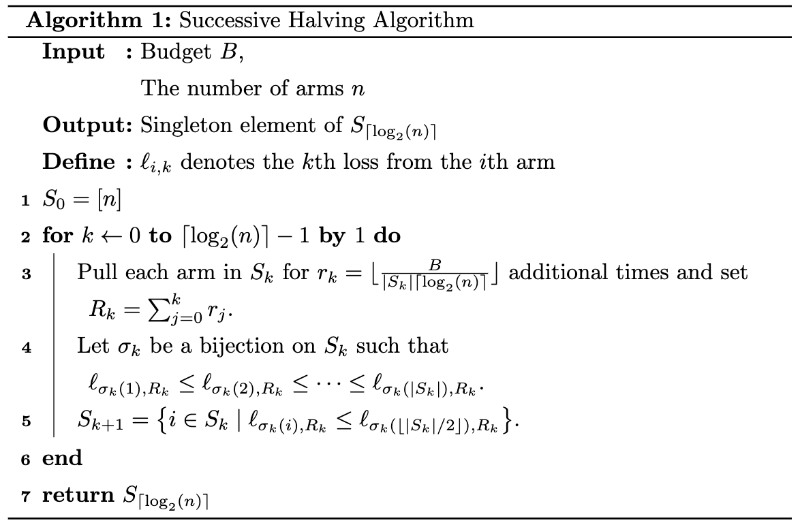

📄 Jamieson, Kevin, and Ameet Talwalkar. "Non-stochastic best arm identification and hyperparameter optimization." *Artificial intelligence and statistics*. PMLR, 2016.

<!--more-->

## Non-stochastic Best Arm Identification

Successive Halving Algorithm은 Bandit 기반의 하이퍼파라미터 최적화 기법입니다. Bandit이라는 단어를 들으면 가장 먼저 떠오르는 것이 A/B 테스트에 많이 사용되는 Multi-armed Bandit입니다. 여러 개의 슬롯머신이 있고, 그 슬롯머신의 팔 (arm)을 당겨서 보상 (reward)을 얻게 됩니다. 이 보상은 어떤 확률 분포로 나타나는데, 어떤 전략으로 슬롯머신을 골라야 최대의 보상을 얻는지에 관한 내용이 바로 MAB입니다. MAB 문제를 푸는 방법은 크게 두 개로 나눌 수 있는데요. 하나는 가장 큰 보상을 주는 최선의 슬롯머신의 팔을 찾는 것이고, 하나는 일반적으로 많이 다루는 Exploration-Exploitation Trade-off를 해결하는 것입니다. 본 글에서 다루는 Successive Halving Algorithm은 첫 번째 방법인 **Best Arm Identification**을 기반에 두고 있습니다.

### Stochastic vs Non-stochastic

Best Arm Identification 방법도 크게 Stochastic한 환경과 Non-stochastic한 환경으로 나뉩니다. 논문에서는 이렇게 표현하고 있습니다.

>**Stochastic**
>
>모든 $i \in [n], k \geq 1$에 대해서 $\mathbb{E}[\ell_{i, k}] = \mu_i$를 만족하는 $\ell_{i,k}$를 $[0, 1]$ 구간 내의 **확률 분포에서 뽑은 i.i.d 샘플**로 두자.
>이때 $\sum^n_{i=1} T_i$를 최소화하는 동안 $\arg\min_i \mu_i$를 찾는 것이 목적이다.
>
>**Non-stochastic**
>
>모든 $i \in [n], k\geq 1$에 대해서 **알고리즘의 행동에 독립적인 Loss sequence $\ell_{i, k} \in \mathbb{R}$을 생성**한다고 하자. 더 나아가 $\nu_i = \lim_{\tau \to \infty} \ell_{i, \tau}$가 존재한다고 가정하자.
>이때 $\sum^n_{i=1} T_i$를 최소화하는 동안 $\arg\min_{i} \nu_i$를 찾는 것이 목적이다.

표현이 어렵지만 각 환경에서 중요한 부분은 **$\ell_{i, k}$를 어떻게 정의하느냐**입니다. Stochastic한 방법은 $\ell_{i, k}$를 확률 분포에서 뽑은 i.i.d 샘플을, Non-stochastic한 방법에서는 알고리즘에 독립적인 어떤 순열을 생성합니다.

하이퍼파라미터 최적화는 Non-stochastic 환경에서의 Bandit 문제로 볼 수 있습니다. 슬롯머신의 팔은 하나의 하이퍼파라미터 설정으로, $\ell_{i, k}$는 학습하는 모델의 손실 함수 값으로 볼 수 있습니다. 이때 non-stochastic하고 oblivious한 결과를 얻게 되는데요. 손실 함수의 값은 **확률적이 아닌 결정론적(deterministic)으로** 나오고, 각각의 하이퍼파라미터 설정과 손실 함수의 값에 대한 **정보를 공유하지 않기 때문**입니다. 이런 관점에서 본 논문에서도 Non-stochastic한 Best Arm Identification으로 프레이밍하여 방법론을 제안하고 있습니다.

### Non-stochastic이 쉽지 않은 이유

Stochastic한 환경은 몇 가지 설정을 통해 Non-stochastic한 환경으로 바뀔 수 있습니다. Stochastic한 환경에서의 Loss 값인 $\ell^\prime\_{i, T_i}$ 를 이용해 $\ell\_{i, T_i} = \frac{1}{T_i} \sum^{T_i}_{k=1} \ell^\prime\_{i, T_i}$ 로 설정하면 됩니다. 이 때 큰 수의 법칙에 의해 다음이 성립합니다.

$$
\lim_{\tau \to \infty} \ell_{i, \tau} = \mathbb{E}[\ell^\prime_{i, 1}].
$$

그리고 $\ell\_{i, T_i} = \min \left\\{ \ell^\prime\_{i, 1}, \cdots, \ell^\prime\_{i, T_i} \right \\}$ 로 둔다면 $\ell\_{i, t}$ 는 bounded, monotonically decreasing sequence가 됩니다. 따라서 $\ell\_{i, t}$ 는 [Monotone Convergence Theorem](https://en.wikipedia.org/wiki/Monotone_convergence_theorem)에 의해 반드시 극한값을 갖게 됩니다.

Stochastic한 환경과 Non-stochastic한 환경의 차이는 극한값으로 수렴하는 속도에서 나타납니다. Stochastic한 환경은 수렴하는 속도를 알 수 있지만 Non-stochastic 환경은 알 수 없습니다. Stochastic한 설정에서 $\hat{\mu}\_{i, T_i} = \frac{1}{T_i} \sum^{T_i}\_{k=1} \ell\_{i, k}$로 뒀을 때 모든 $i \in [n], T_i > 0$ 에 대해 다음을 만족합니다.

$$
\left| \hat{\mu}_{i, T_i} - \mu_i \right| \leq \sqrt{\frac{\log(4nT_i^2)}{2T_i}}.
$$

>**이 식이 성립하는 이유는?**
>
>*$X_t$가 $[0, 1]$ 안에 있고, $n > 1$ 일 때 다음이 성립한다.*
>
>$$ P \left( \bigcup^\infty_{t=1} \left\{ \left| \frac{1}{t} \sum^t_{s=1} X_s - \mathbb{E}[X_s] \right| \geq \sqrt{\frac{\log(4nt^2)}{2t}} \right\} \right) \leq \frac{1}{n}. $$
>
>**증명.**
>
>[Boole's Inequality](https://en.wikipedia.org/wiki/Boole%27s_inequality)에 의해서 다음이 성립합니다.
>
>$$ P \left( \bigcup^\infty_{t=1} \left\{ \left| \frac{1}{t} \sum^t_{s=1} X_s - \mathbb{E}[X_s] \right| \geq \sqrt{\frac{\log(4nt^2)}{2t}} \right\} \right) \leq \sum^\infty_{t=1} P \left( \left| \frac{1}{t} \sum^t_{s=1} X_s - \mathbb{E}[X_s] \right| \geq \sqrt{\frac{\log(4nt^2)}{2t}} \right). $$
>
>[Hoeffding's Inequality](https://en.wikipedia.org/wiki/Hoeffding%27s_inequality)와 무한 급수를 사용하여 다음을 얻을 수 있습니다.
>
>$$\begin{aligned}
>\sum^\infty_{t=1} P \left( \left| \frac{1}{t} \sum^t_{s=1} X_s - \mathbb{E}[X_s] \right| \geq  \sqrt{\frac{\log(4nt^2)}{2t}} \right) &\leq \sum^\infty_{t=1} 2e^{-\log(4nt^2)} \\
>&\leq \sum^\infty_{t=1} \frac{2}{4nt^2} \\ 
>&\leq \sum^\infty_{t=1} \frac{1}{2nt^2} \\
>&\leq \frac{1}{2n} \sum^\infty_{t=1} \frac{1}{t^2} \\
>&= \frac{1}{2n} \cdot \frac{\pi^2}{6} \\
>&\leq \frac{1}{2n} \cdot 2 = \frac{1}{n} &\blacksquare
>\end{aligned}$$

Non-stochastic한 환경에서의 가정은 $\lim_{\tau \to \infty} \ell_{i, \tau}$ 가 존재하면 다음을 만족하는 증가하지 않는 함수 $\gamma_i$ 가 존재한다는 것입니다.

$$
\left| \ell_{i, t} - \lim_{\tau \to \infty} \ell_{i, \tau} \right| \leq \gamma_{i}(t) \to 0 \quad \text{ as} \quad t \to \infty
$$

위 내용은 극한값으로의 수렴은 보장해주지만 **얼마나 빨리** $\gamma_i(t)$ 가 0으로 도달하는지는 알려주지 않습니다. 이 사실은 다음의 두 가지 결과로 나타낼 수 있습니다.

1.   결국 Best Arm이 존재하기는 한다.
2.   Best Arm인지 확인할 수 없거나 Best Arm의 정확한 값을 알아낼 수 없다.

본 논문은 기존에 제안되었던 Successive Halving Algorithm에 대해 위 내용을 통해 정해진 예산(budget) 내에서 하이퍼파라미터를 최적화하는 효과적이고 효율적인 방법을 제안합니다.

## Successive Halving Algorithm

{: w="600"}
_Pseudo-code for SHA_

Successive Halving Algorithm은 다음 순서로 작동합니다.

-   입력값으로 예산 $B$ 와 하이퍼파라미터 설정값 개수 $n$ 을 갖습니다. 
    -   두 개의 입력값 중 예산 $B$ 는 $B \leftarrow n$, $B \leftarrow 2B$ 로 설정하는 더블링 트릭 (doubling trick)으로 없앨 수 있습니다. 
-   그 다음 최초 하이퍼파라미터 설정 집합 $S_0$ 을 초기화합니다.
-   다음의 과정을 하나의 하이퍼파라미터 설정이 남을 때까지 반복합니다.
    -   $S_k$ 에 남아 있는 하이퍼파라미터 설정들로 모델을 $r_k$ Epoch 만큼 더 학습하고 $R_k$ 를 지금까지 학습한 Epoch 수로 설정합니다.
    -   학습한 모델 중에서 손실 함수 값인 $\ell_{i, k}$ 를 기준으로 성능이 좋지 않은 절반의 하이퍼파라미터 설정값을 버립니다.
    -   남은 하이퍼파라미터 설정을 $S_{k+1}$ 로 설정합니다.
-   마지막으로 남은 하이퍼파라미터 설정을 반환합니다.

### 실제 예시

![Figure from [1]](/assets/images/2022-12-24-successive-halving-algorithm/sha_example.png){: w="500"}
_Figure from [1]_

이해를 위해서 직접 값을 대입하여 알고리즘이 어떻게 작동하는지 알아보도록 하겠습니다. 우선 예산 $B$ 를 32로, 하이퍼파라미터 설정값 개수 $n$ 은 8로 가정하겠습니다. 그러면 최초 하이퍼파라미터 설정 집합 $S_0$ 의 크기는 당연히 8이고, 알고리즘의 반복은 $k=0$ 부터 $k = \lfloor \log_2(n) \rfloor -1 = 2$ 까지 진행합니다.

1.   $k=0$
     -   $r_0 = \lfloor \frac{32}{ \|S_0\| \lceil \log_2(8) \rceil} \rfloor = \lfloor \frac{32}{8 \cdot 3} \rfloor = 1$
     -   $S_0$ 내 모든 하이퍼파라미터를 1 Epoch 만큼 학습하고, 성능이 낮은 절반을 버립니다.
     -   따라서 $\|S_1\| = 4$ 가 됩니다.
2.   $k=1$
     -   $r_1 = \lfloor \frac{32}{\|S_1\| \lceil \log_2(8) \rceil} \rfloor = \lfloor \frac{32}{4 \cdot 3} \rfloor = 2$
     -   $S_1$ 내 모든 하이퍼파라미터를 2 Epochs 만큼 학습하고, 성능이 낮은 절반을 버립니다.
     -   따라서 $\|S_2\| = 2$ 가 됩니다.
3.   $k=2$
     -   $r_2 = \lfloor \frac{32}{\|S_2\| \lceil \log_2(8) \rceil} \rfloor = \lfloor \frac{32}{2 \cdot 3} \rfloor = 5$
     -   $S_2$ 내 모든 하이퍼파라미터를 5 Epochs 만큼 학습하고, 성능이 낮은 절반을 버립니다.
     -   따라서 $\|S_3\| = 1$이 되고, $S_3$에 존재하는 단 하나의 하이퍼파라미터를 반환합니다. 이 하이퍼파라미터가 SHA에서 찾는 최적 하이퍼파라미터입니다.

### SHA의 수렴성 보장

>   아래 내용은 자세한 이해를 원하시는 경우에만 보시면 됩니다. 필수적인 내용은 아닙니다. 😀

보기에는 간단해보이는데 이 알고리즘이 최적 하이퍼파라미터를 잘 찾아준다는 보장, 즉 **알고리즘의 수렴성 보장**은 어떻게 되는걸까요? 논문에서는 여러 정리(Theorem)를 이용하여 수렴성에 대한 내용을 엄밀하게 다루고 있는데, 본 포스트에서는 약식으로 다루도록 하겠습니다.

#### (1) 전체 샘플의 수가 예산을 넘지 않음

우선 알고리즘에서 발생하는 전체 샘플이 예산 $B$를 넘지 않는 것부터 보여야 합니다. 만약 넘게 된다면 수렴은 둘째치고 알고리즘의 유효성이 사라지니까요. 전체 샘플의 수는 매 단계마다의 하이퍼파라미터 집합 내 원소의 수와 학습할 Epoch 수를 곱한 것과 같으므로 다음과 같습니다.

$$
\text{\#Samples} = \sum_{k=0}^{\lceil \log_2(n) \rceil -1} |S_k| \left\lfloor \frac{B}{|S_k| \lceil \log_2(n) \rceil} \right\rfloor
$$

여기서 floor function의 성질을 이용해야 합니다.. 분모에 있는 $\|S_k\|$ 는 자연수이기 때문에 이 값을 floor function 밖으로 뺐을 때 소숫점 아래 수가 발생해서 $\|S_k\|$ 를 floor function 밖으로 뺐을 때가 더 큰 수가 됩니다. 따라서 다음과 같이 정리할 수 있습니다.

$$
\begin{aligned}
\sum_{k=0}^{\lceil \log_2(n) \rceil -1} |S_k| \left\lfloor \frac{B}{|S_k| \lceil \log_2(n) \rceil} \right\rfloor &\leq \sum_{k=0}^{\lceil \log_2(n) \rceil -1} |S_k| \frac{1}{|S_k|} \left\lfloor \frac{B}{\lceil \log_2(n) \rceil} \right\rfloor \\
&= \sum_{k=0}^{\lceil \log_2(n) \rceil -1} \left\lfloor \frac{B}{\lceil \log_2(n) \rceil} \right\rfloor \\
& \leq \sum_{k=0}^{\lceil \log_2(n) \rceil -1} \frac{B}{\lceil \log_2(n) \rceil} = B
\end{aligned}
$$

따라서 알고리즘에서 발생하는 전체 샘플의 수는 예산보다 작거나 같습니다.

#### (2) 수렴성 보장

모든 하이퍼파라미터 설정 $i = 1, 2, \cdots, n$에 대해서 다음을 정의합니다.

$$
\nu_i = \lim_{\tau \to \infty} \ell_{i, \tau}
$$

이 값은 위에서의 Non-stochastic한 환경에서의 가정에 의해 반드시 존재하는 값입니다. 일반성을 잃지 않고 다음과 같이 가정하겠습니다. 단순히 각 하이퍼파라미터 설정을 성능 순으로 재정렬했다고 생각하면 됩니다.

$$
\nu_1 \leq \nu_2 \leq \cdots \leq \nu_n.
$$

그리고 각각의 $i = 1, 2, \cdots, n$에 대해서 다음을 만족하는 point-wise smallest, non-increasing한 $t$에 대한 함수 $\gamma_i(t)$ 를 정의합니다.

$$
\left| \ell_{i, t} - \nu_i \right| \leq \gamma_i(t) \quad \forall t. \tag{*}
$$

$\gamma_i(t)$ 는 $\ell_{i, t}$ 와 그 극한값 $\nu_i$ 의 차이를 bound하는 어떤 함수가 됩니다. 여기까지 정의가 되었다면 임의의 하이퍼파라미터 설정 $i$ 의 어떤 시점 $t_i$ 에서의 손실 함수값 $\ell\_{i, t_i}$ 와 가장 성능이 좋게 나올 하이퍼파라미터 설정의 어떤 시점 $t_1$ 에서의 손실 함수값 $\ell\_{1, t_1}$ 의 차이를 계산해봅시다. 

$$
\begin{aligned}
\ell_{i, t_i} - \ell_{1, t_1} &= (\ell_{i, t_i} - \nu_i) + (\nu_1 - \ell_{1, t_1}) + 2\left(\frac{\nu_i - \nu_1}{2}\right) \\
& \geq -\gamma_i(t_i) - \gamma_1(t_1) + 2\left(\frac{\nu_i - \nu_1}{2}\right) & \text{by (*)}
\end{aligned}
$$

여기서 $\gamma_i(t)$ 에 대한 유사 역함수를 고려합니다.

$$
\gamma_i^{-1}(\alpha) = \min \{ t \in \mathbb{N} \mid \gamma_i(t) \leq \alpha \} \quad \forall i \in [n]
$$

만약 $t_i > \gamma_i^{-1} \left( \frac{\nu_i - \nu_1}{2} \right)$이면서 $t_1 > \gamma_1^{-1} \left( \frac{\nu_i - \nu_1}{2} \right)$ 라면 $\gamma_i(t)$ 는 non-increasing function이기 때문에 다음이 성립합니다.

$$
\gamma_i(t_i) < \frac{\nu_i - \nu_1}{2} \quad \text{and} \quad \gamma_1(t_1) < \frac{\nu_i - \nu_1}{2}
$$

따라서 식 (12)는 다음과 같이 다시 쓸 수 있습니다.

$$
\begin{aligned}
\ell_{i, t_i} - \ell_{1, t_1} &= (\ell_{i, t_i} - \nu_i) + (\nu_1 - \ell_{1, t_1}) + 2\left(\frac{\nu_i - \nu_1}{2}\right) \\
& \geq -\gamma_i(t_i) - \gamma_1(t_1) + 2\left(\frac{\nu_i - \nu_1}{2}\right) > 0
\end{aligned}
$$

보다 엄밀하게 말하자면 다음이 성립합니다.

$$
\min \{ t_i, t_1 \} > \max \left\{ \gamma_i^{-1} \left( \frac{\nu_i - \nu_1}{2} \right), \gamma_1^{-1} \left( \frac{\nu_i - \nu_1}{2} \right) \right\} \implies \ell_{i, t_i} > \ell_{1, t_i}
$$

이를 통해 적당한 임의의 두 시점, $t_i$와 $t_1$에서 $\ell_{i, t_i} > \ell_{1, t_1}$ 가 성립한다면 학습 중간의 손실 함수를 비교하는 것만으로 최종 수렴값인 $\nu_i$와 $\nu_1$의 대소 관계를 비교할 수 있다는 것을 알 수 있습니다. 직관적으로 생각해본다면 $\gamma_i(t)$가 두 수렴값 $\nu_i$와 $\nu_1$의 평균보다 작아지게 되는 $t$는 **충분히 큰 수**가 될 것입니다. $t$를 크게 잡기 위해선 총 예산 $B$를 충분히 크게 잡아야 합니다. 따라서 충분히 큰 $B$ 값을 갖는다면 이는 결국 SHA가 최적의 하이퍼파라미터 설정을 찾아내기에 충분하게 됩니다.

## 레퍼런스

[1] Feurer, Matthias, and Frank Hutter. "Hyperparameter optimization." *Automated machine learning*. Springer, Cham, 2019. 3-33.